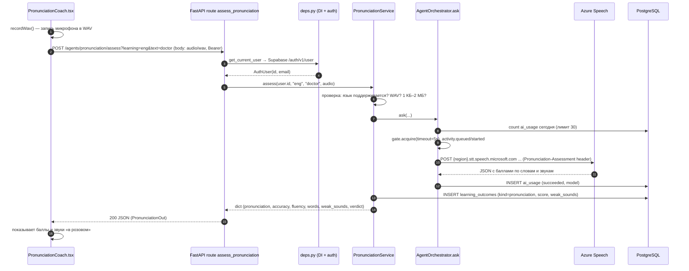

# 3. API REFERENCE — Мой бэкенд API

> Все эндпоинты проверены по файлам `src/langapp/api/routes/*.py` и схемам `src/langapp/api/schemas.py`. **[VERIFIED]**
> Интерактивная документация FastAPI доступна при запущенном бэкенде: `http://localhost:8000/docs`.
> Во фронтенде пути начинаются с `/api` (прокси Vite), на бэкенде — без `/api`.

---

## 3.1. Базовые понятия на примерах из проекта

| Понятие | Простое объяснение | Пример из TurtleTalk |
|---|---|---|
| **API** (Application Programming Interface) | «Меню ресторана» для программ: список того, что можно попросить у сервера и в каком виде | Весь набор маршрутов FastAPI — это API бэкенда |
| **Endpoint** | Один пункт меню: адрес + метод | `POST /agents/grammar/check` |
| **HTTP request** | Сообщение «клиент → сервер»: метод, адрес, заголовки, иногда тело | Фронтенд просит список тем: `GET /lessons?learning=eng&native=spa` |
| **HTTP response** | Ответ «сервер → клиент»: статус, заголовки, тело | `200 OK` + JSON со списком тем |
| **HTTP methods** | Глагол запроса: `GET` читать, `POST` создать/выполнить действие, `PUT` заменить, `DELETE` удалить | `PUT /settings` заменяет выбор языков целиком. `DELETE` в проекте **не используется** |
| **Request body** | Данные в теле запроса (обычно JSON) | `{"concept_id": 12, "learning": "eng", "native": "spa", "sentence": "The doctor reads"}` |
| **Response body** | Данные в теле ответа | `{"available": true, "explanation": "...", "mistakes": [...]}` |
| **Query parameters** | Параметры в URL после `?` | `?learning=eng&native=spa` |
| **Headers** | Служебные строки запроса | `Authorization: Bearer eyJ...` (токен), `Content-Type: application/json` |
| **Status codes** | Число-итог | `200` ок, `400` неверный запрос, `401` нет/плохой токен, `403` нет прав, `404` не найдено, `422` не прошла валидация Pydantic, `429` превышен лимит, `502` ошибка внешнего сервиса, `503` сервис недоступен |
| **Authentication** | Проверка «кто ты» | Токен Supabase проверяется в `get_current_user` (`api/deps.py`) |
| **Authorization** | Проверка «что тебе можно» | Только админ может `GET /agents/usage/summary` (`get_admin_user`) |

**Аналогия.** Эндпоинт — это окошко в госучреждении. Метод — что вы хотите (получить справку / подать заявление). Заголовки — паспорт (токен). Тело — заполненный бланк. Статус-код — штамп «принято», «отказано: нет паспорта» (401), «отказано: не ваш отдел» (403), «бланк заполнен неверно» (422).

---

## 3.2. Обзор всех эндпоинтов (33 штуки, включая служебный `GET /`)

Обозначения: 🔓 — без входа, 🔐 — нужен токен (`CurrentUser`), 👑 — только админ (`AdminUser`), 🤖 — вызывает AI-агента.

### System (`routes/system.py`)
| Метод | Путь | Доступ | Что делает | БД |
|---|---|---|---|---|
| GET | `/health` | 🔓 | Состояние базы и число предложений; `503`, если база недоступна | чтение |
| GET | `/import-runs?limit=10` | 🔓 | Последние запуски импорта из Tatoeba со счётчиками | чтение `import_runs` |
| GET | `/` | 🔓 | Отдаёт `web/index.html` (служебная страница) | — |

### Sentences (`routes/sentences.py`)
| Метод | Путь | Доступ | Что делает | БД |
|---|---|---|---|---|
| GET | `/sentences?lang&translation_lang&q&limit&offset` | 🔓 | Поиск и постраничный список предложений | чтение |
| GET | `/sentences/random?lang&translation_lang` | 🔓 | Одно случайное предложение | чтение |
| GET | `/sentences/{sentence_id}` | 🔓 | Предложение со всеми переводами | чтение |

### Games — свободная практика (`routes/games.py`)
| Метод | Путь | Доступ | Что делает | БД |
|---|---|---|---|---|
| GET | `/game/sentences?limit=20&max_words=8` | 🔓 | Раунд Sentence Builder: короткие английские предложения с переводами и аудио | чтение |
| GET | `/game/wordmatch?language=en-es&limit=5` | 🔓 | Пары слов для Word Match | чтение `word_pairs` |

### Lessons / Topics (`routes/lessons.py`)
| Метод | Путь | Доступ | Что делает | БД |
|---|---|---|---|---|
| GET | `/languages` | 🔓 | Языки, для которых есть слова | чтение |
| GET | `/lessons?learning=eng&native=spa` | 🔓 | Список тем с числом слов и предложений | чтение |
| GET | `/lessons/{lesson_id}?learning&native` | 🔓 | Слова темы, 10 случайных предложений для Shuffle, раунды Picture | чтение |
| GET | `/settings` | 🔐 | Сохранённые языки ученика; `404`, если не сохранял | чтение `user_settings` |
| PUT | `/settings` | 🔐 | Сохранить языки (`native_lang ≠ learning_lang`) | запись |

> Во фронтенде темы называются «Topics», в коде и URL — `lessons` (переименован только интерфейс). **[VERIFIED]**

### Progress (`routes/progress.py`)
| Метод | Путь | Доступ | Тело запроса | БД |
|---|---|---|---|---|
| POST | `/progress/sentence` | 🔐 | `{exercise_id: int>0, correct: bool}` | upsert `user_progress` |
| POST | `/progress/word` | 🔐 | `{lemma, language: "en-es", correct}` | upsert |
| POST | `/progress/lesson-word` | 🔐 | `{concept_id, learning, correct}`; `404`, если слова нет | upsert |
| POST | `/progress/lesson` | 🔐 | `{lesson_id: int>0, correct}` | upsert |
| GET | `/progress/sentences` | 🔐 | — → карта `{exercise_id: {attempts, correct, mastery, last_attempted, next_review}}` | чтение |
| GET | `/progress/lessons` | 🔐 | — → карта `{lesson_id: {attempts, correct, mastery}}` | чтение |

Ответ всех `POST /progress/*`: `{mastery: 0..5, next_review_at: datetime}`.

### Mnemonics — карточки-картинки (`routes/mnemonics.py`)
| Метод | Путь | Доступ | Что делает | Ошибки |
|---|---|---|---|---|
| GET | `/mnemonics?learning&native` | 🔐 | Свои карточки + подписанные ссылки на картинки + сколько картинок ещё можно сегодня | 400 |
| POST | `/mnemonics` | 🔐 | `{concept_id, learning, native, sentence (1–500)}` → создать/обновить карточку и нарисовать картинку | 400, 404, 429 |

### Agents (`routes/agents.py`)
| Метод | Путь | Доступ | Что делает | Агент |
|---|---|---|---|---|
| GET | `/agents/usage` | 🔐 | Сколько AI-ответов использовано сегодня, сколько осталось, `is_admin` | — |
| GET | `/agents/usage/summary?days=7` | 👑 | Статистика всех агентов за 1–90 дней | — |
| GET | `/agents/live` | 👑 | Живые состояния агентов + 30 последних вызовов | — |
| POST | `/agents/grammar/check` | 🔐 | `{sentence_id, answer: [плитки], learning, native}` → объяснение ошибки | 🤖 Grammar |
| GET | `/agents/vocabulary/weak?learning&native&lesson_id&limit=3` | 🔐 | Слова, где ученик ошибался чаще всего | — (без LLM) |
| POST | `/agents/vocabulary/help` | 🔐 | `{concept_id, learning, native}` → примеры, синонимы, антонимы, совет | 🤖 Vocabulary |
| POST | `/agents/conversation/start` | 🔐 | `{mnemonic_id, learning, native}` → первая реплика собеседника | 🤖 Conversation |
| POST | `/agents/conversation/turn` | 🔐 | + `history` (≤20 реплик), `message` (1–300) → ответ + исправление | 🤖 Conversation |
| POST | `/agents/conversation/finish` | 🔐 | `{messages, corrections}` → сохраняет использованные слова и ошибки | — (без LLM) |
| POST | `/agents/cultural/explain` | 🔐 | `{concept_id, learning, native}` → культурная заметка, идиомы, факт | 🤖 Cultural |
| GET | `/agents/pronunciation/support?learning` | 🔐 | Доступна ли оценка произношения для языка | — |
| POST | `/agents/pronunciation/assess?learning&text` | 🔐 | Тело — WAV-аудио (1 КБ–2 МБ) → баллы произношения | 🤖 Pronunciation (Azure) |

Ошибки агентских эндпоинтов (`AGENT_ERRORS`): `400`, `404`, `429` (дневной лимит или лимит провайдера), `503` (все слоты заняты дольше 5 с). **[VERIFIED]**

---

## 3.3. Карточки важных эндпоинтов

### `POST /agents/grammar/check`
| Поле | Объяснение |
|---|---|
| HTTP method | POST — выполняет действие (вызов AI), а не просто читает |
| Endpoint | `/agents/grammar/check` |
| Purpose | Объяснить, почему ученик собрал предложение в неправильном порядке |
| Authentication | Да, `CurrentUser` (Bearer-токен Supabase) |
| Input | `GrammarCheckIn`: `sentence_id: int`, `answer: list[str]` (1–40 плиток по 1–60 символов), `learning`, `native` (коды вида `eng`) |
| Output | `GrammarCheckOut`: `correct`, `available`, `explanation`, `mistakes[{wrong,right,why}]`, `tip`, `cached`, `message`, `remaining_today` |
| Database | Читает предложение и перевод; пишет `ai_usage` (каждый вызов) и `learning_outcomes` (kind=`mistake`) |
| Agent | Grammar Agent через `AgentOrchestrator.ask` |
| Errors | 404 предложение не найдено; 400 плитки не те; 429 лимит 30/день или провайдер занят; 503 нет свободного слота; при сбое модели — **200** с `available=false` и `message` |

### `POST /mnemonics`
| Поле | Объяснение |
|---|---|
| Purpose | Сохранить своё предложение со словом и нарисовать к нему картинку |
| Auth | 🔐 |
| Input | `MnemonicIn` (`concept_id>0`, `learning`, `native`, `sentence` 1–500; сервис дополнительно требует 3–200 символов и само слово в предложении) |
| Output | `MnemonicOut`: id, слово, перевод, emoji, текст, `masked_sentence` (слово заменено на `___` для флешкарт), `image_url` |
| Database | upsert в `mnemonics` (одна карточка на пользователя+слово+пару языков), запись в `image_generations` |
| External | OpenRouter `/images` (генерация), Supabase Storage (сохранение, подпись ссылок) |
| Errors | 404 слово не найдено/нет перевода; 400 предложение без слова; 429 лимит картинок в день |

### `GET /agents/live` (админ)
| Поле | Объяснение |
|---|---|
| Purpose | Показать, что каждый агент делает **прямо сейчас** (для 3D Control Room) |
| Auth | 👑 (`ADMIN_EMAILS`) — иначе 403, без токена 401 |
| Output | `AgentsLiveOut`: `agents[]` (state: idle / waiting / thinking / working / success / error / blocked, detail, running_ms, average_ms, calls_today…), `recent[]` (30 последних вызовов из `ai_usage`) |
| Источник данных | Память процесса (`AgentActivity`) + БД (`ai_usage`) |
| Контракт | Описан в `openapi.yaml` и проверяется тестом `tests/test_agents_live.py` |

---

## 3.4. Полный жизненный цикл запроса (request–response lifecycle)

Пример: **ученик проверяет произношение слова «doctor»**.

**Шаги простыми словами:**
1. **Frontend request** — `assessPronunciation()` в `lib/agentsApi.ts` отправляет аудио как тело запроса (`Content-Type: audio/wav`), слово — в query.
2. **Backend route** — `routes/agents.py::assess_pronunciation` получает `learning`, `text` (1–80 символов) и `audio: bytes`.
3. **Validation** — FastAPI/Pydantic проверяют типы и длину; сервис проверяет, что это действительно WAV (`is_wav`: байты `RIFF…WAVE`) и размер.
4. **Business logic** — `PronunciationService.assess` выбирает локаль (`en-US`, `es-ES`, `ca-ES`), зовёт оркестратор.
5. **Database** — оркестратор считает сегодняшние вызовы пользователя; после ответа пишет `ai_usage`; сервис пишет `learning_outcomes`.
6. **Response** — словарь превращается в `PronunciationOut` (FastAPI сам сериализует в JSON).
7. **Frontend handling** — `PronunciationCoach.tsx` показывает общий балл, слова и слабые звуки; если `available=false`, показывает `message`.

---

## 3.5. API-контракт (`openapi.yaml`)

- В корне проекта есть `openapi.yaml` (OpenAPI 3.1) — **«контракт»**: описание, какие поля обязаны быть в ответе. **[VERIFIED]**
- Правило проекта: «новые потребности сначала добавляются сюда, вместе с записью решения в `docs/decisions/`». **[VERIFIED]** — текст в `openapi.yaml`, раздел `info.description`.
- В контракте **7 операций**: `GET /sentences` (фильтры `lang`, `translation_lang`, `q` + пагинация `limit`/`offset`, ответ с `total`), `GET /sentences/{sentence_id}`, `GET`/`POST /mnemonics` (запись с валидацией: 422 — форма тела, 400 — правило приложения, 429 — лимит), `/agents/usage`, `/agents/usage/summary`, `/agents/live`. Nullable-поля: `Sentence.license`, `Sentence.owner`, `Mnemonic.emoji`, `Mnemonic.image_url`. Решение записано в ADR 0004. **[VERIFIED]**
- Остальные 26 эндпоинтов (уроки, игры, прогресс, агенты) пока только в автоматической документации FastAPI `/docs`. **[VERIFIED]**
- Контракт проверяется линтером: `npx @redocly/cli lint openapi.yaml` — ошибок нет; добавлен в `make lint` и отдельной задачей в CI. **[VERIFIED]**
- `tests/test_contract.py` для каждой операции контракта проверяет, что в коде **те же параметры, то же тело запроса и те же поля ответа**; `tests/test_api.py` и `tests/test_mnemonics.py` проверяют настоящие ответы (200, 400, 404, 422) по схемам контракта через `jsonschema`. **[VERIFIED]**
