# 5. DATABASE GUIDE — База данных и поток данных

> Источник истины: `src/langapp/db/models.py` (модели SQLAlchemy) и `migrations/versions/*.py` (6 миграций Alembic). **[VERIFIED]**
> База: **PostgreSQL 17** в Docker (`docker-compose.yml`), порт **5433**, база `langapp`; для тестов — `langapp_test`.

---

## 5.1. Главная особенность: пользователей в нашей базе НЕТ

В базе **нет таблицы `users`**. Пользователи живут в **Supabase Auth**. Наши таблицы хранят только `user_id` (UUID из Supabase) **без внешнего ключа** (foreign key), потому что таблица пользователей находится в другой системе. **[VERIFIED]** — во всех моделях `user_id: Mapped[uuid.UUID] = mapped_column(Uuid)` без `ForeignKey`.

**Плюс:** не нужно хранить пароли и писать регистрацию. **Минус:** база не может гарантировать, что такой пользователь существует, и при удалении пользователя в Supabase его данные у нас **не удалятся автоматически** (нет каскада). **[INFERRED]**

---

## 5.2. Все таблицы (16) по группам

### A. Контент из Tatoeba (импортируется CLI)
| Таблица | Ответственность | Primary key | Важное |
|---|---|---|---|
| `sentences` | Предложение на любом языке | `id` — **id из Tatoeba** (не автоинкремент) | индекс по `lang`; `license`, `owner`, `word_count`, `is_unapproved` |
| `sentence_links` | «Это предложение — перевод того» | составной `(sentence_id, translation_id)` | оба FK → `sentences.id` `ON DELETE CASCADE`; `CHECK sentence_id <> translation_id`; `is_direct` (прямой или косвенный перевод) |
| `audios` | Записи носителей | `id` из Tatoeba | FK `sentence_id` → `sentences` (CASCADE); `download_url`, `author`, `license`, `attribution_url` |
| `import_runs` | Журнал каждого импорта | `id` (Identity) | `CHECK status IN ('running','succeeded','failed')`; счётчики `fetched/inserted/updated/skipped`, `last_cursor`, `error` |

### B. Словарь и темы
| Таблица | Ответственность | Primary key | Важное |
|---|---|---|---|
| `word_pairs` | Пары слов из старых JSON-словарей (для Word Match) | `id` | `UNIQUE(pair, source_text, target_text)` — повторный импорт не дублирует |
| `concepts` | Одно **значение** слова, независимо от языка (например «doctor») | `id` | `slug` UNIQUE, `category` (индекс), `emoji`, `image_url`, `image_approved` |
| `concept_terms` | Слово для концепта на конкретном языке | `(concept_id, lang)` | FK → `concepts` CASCADE. Так одна тема работает для любой пары языков |
| `lessons` | Тема («People», «Places»…) | `id` | `slug` UNIQUE, `position` UNIQUE |
| `lesson_concepts` | Какие слова в теме | `(lesson_id, concept_id)` | оба FK CASCADE; `position` |
| `lesson_sentences` | Какие предложения Tatoeba подобраны к теме и к какому слову | `(lesson_id, sentence_id)` | FK `concept_id` (индекс) — для какого слова предложение |

### C. Данные ученика (по `user_id`)
| Таблица | Ответственность | Primary key | Важное |
|---|---|---|---|
| `user_settings` | Выбранные языки и уровень | `user_id` | `CHECK native_lang <> learning_lang`; `CHECK level IN ('A1'…'C2')` |
| `user_progress` | Интервальное повторение по любому «предмету» | `(user_id, item_type, item_key)` | `CHECK item_type IN ('sentence','word','lesson')`; `CHECK mastery_level BETWEEN 0 AND 5`; `next_review_at` |
| `mnemonics` | Карточка-картинка ученика | `id` | `UNIQUE(user_id, concept_id, learning_lang, native_lang)` — одна карточка на слово; `CHECK length(text) > 0`; индекс `(user_id, created_at)`; `image_path` в Supabase Storage |
| `image_generations` | Журнал попыток генерации картинок (для лимита) | `id` | индекс `(user_id, created_at)`; `succeeded`, `model` |

### D. Наблюдаемость AI
| Таблица | Ответственность | Primary key | Важное |
|---|---|---|---|
| `ai_usage` | **Каждый** вызов агента: кто, какой агент, модель, успех, токены, время | `id` | индекс `(user_id, created_at)` — для дневного лимита |
| `learning_outcomes` | **Результаты** работы агентов: ошибки, использованные слова, баллы произношения | `id` | `agent`, `kind`, `detail` (**JSONB**), FK `lesson_id`/`concept_id` → `ON DELETE SET NULL`; индекс `(user_id, created_at)` |

Плюс служебная таблица `alembic_version` (какая миграция применена).

---

## 5.3. ER-диаграмма

```mermaid
erDiagram
    SENTENCES ||--o{ SENTENCE_LINKS : "sentence_id"
    SENTENCES ||--o{ SENTENCE_LINKS : "translation_id"
    SENTENCES ||--o{ AUDIOS : has
    CONCEPTS ||--o{ CONCEPT_TERMS : "words per language"
    LESSONS ||--o{ LESSON_CONCEPTS : contains
    CONCEPTS ||--o{ LESSON_CONCEPTS : "is in"
    LESSONS ||--o{ LESSON_SENTENCES : uses
    SENTENCES ||--o{ LESSON_SENTENCES : "chosen for"
    CONCEPTS ||--o{ LESSON_SENTENCES : "for word"
    CONCEPTS ||--o{ MNEMONICS : "card for word"
    LESSONS |o--o{ LEARNING_OUTCOMES : "optional"
    CONCEPTS |o--o{ LEARNING_OUTCOMES : "optional"
    SUPABASE_USER ||..o{ USER_SETTINGS : "user_id (no FK)"
    SUPABASE_USER ||..o{ USER_PROGRESS : "user_id (no FK)"
    SUPABASE_USER ||..o{ MNEMONICS : "user_id (no FK)"
    SUPABASE_USER ||..o{ AI_USAGE : "user_id (no FK)"
    SUPABASE_USER ||..o{ LEARNING_OUTCOMES : "user_id (no FK)"
    SUPABASE_USER ||..o{ IMAGE_GENERATIONS : "user_id (no FK)"

    SENTENCES { bigint id PK "Tatoeba id" string lang string text int word_count }
    SENTENCE_LINKS { bigint sentence_id PK bigint translation_id PK bool is_direct }
    CONCEPTS { int id PK string slug UK string category string emoji }
    CONCEPT_TERMS { int concept_id PK string lang PK string text }
    LESSONS { int id PK string slug UK string title int position UK }
    USER_PROGRESS { uuid user_id PK string item_type PK string item_key PK int mastery_level datetime next_review_at }
    MNEMONICS { int id PK uuid user_id int concept_id FK string text string image_path }
    AI_USAGE { int id PK uuid user_id string agent string model bool succeeded int tokens }
    LEARNING_OUTCOMES { int id PK uuid user_id string agent string kind jsonb detail }
```



**Объяснение простыми словами.**
- `sentences` связаны **сами с собой** через `sentence_links`: перевод — это тоже предложение. Поэтому у таблицы ссылок два внешних ключа на одну таблицу.
- **Концепт** — это «смысл» (врач), а **term** — как его пишут на каждом языке (doctor / el médico / врач). Тема содержит концепты, а не слова конкретного языка — поэтому одна и та же тема работает для любой пары «родной → изучаемый».
- `lesson_sentences` соединяет тему, предложение и **слово**, ради которого предложение выбрано.
- Пунктирные линии к `SUPABASE_USER` означают «логическая связь без внешнего ключа»: пользователь хранится во внешней системе.

---

## 5.4. Как данные создаются, читаются, меняются и удаляются (CRUD)

| Операция | Где | Пример |
|---|---|---|
| **Create** (импорт) | `repositories/sentences.py`, `services/import_service.py` | CLI вставляет предложения с `ON CONFLICT` (идемпотентно), одна транзакция на страницу импорта |
| **Create/Update** (upsert прогресса) | `repositories/progress.py::record` | `INSERT ... ON CONFLICT (user_id, item_type, item_key) DO UPDATE` |
| **Read** | все репозитории | `LessonRepository.list_lessons` считает слова и предложения подзапросами |
| **Update** | `repositories/user_settings.py`, `mnemonics.py` | Перезапись языков; «Rewrite» карточки обновляет текст и картинку |
| **Delete** | `repositories/lessons.py::upsert_lessons` | При перепланировании тем старые темы удаляются (CASCADE удаляет их связи), **но** найденные предложения сначала переносятся в новые темы |
| Delete данных ученика | — | **[NOT IMPLEMENTED]** — нет эндпоинтов удаления карточек, прогресса или аккаунта |

---

## 5.5. Важные запросы

### Интервальное повторение (`ProgressRepository.record`) **[VERIFIED]**
```python
step = 1 if correct else -1
new_mastery = least(5, greatest(0, mastery_level + step))
next_review_at = now() + make_interval(days => 2 ** new_mastery)
```
- Правильный ответ: `mastery` +1 (максимум 5); ошибка: −1 (минимум 0).
- Следующий повтор через **2^mastery дней**: 1, 2, 4, 8, 16, 32 дня.
- Всё считается **внутри PostgreSQL одним запросом** (upsert + `RETURNING`), поэтому два одновременных ответа не потеряют счётчик.

**Аналогия:** коробки Лейтнера — карточка, на которую ответили верно, переходит в «дальнюю» коробку и вернётся позже.

### «Трудные слова» (`LearnerService.weak_words`) **[VERIFIED]**
Берёт строки `user_progress` вида `word` с ключом `eng:doctor`, где `correct_count < attempts`, сортирует по доле верных ответов (меньше — выше), затем по числу попыток. **Без LLM** — это обычный запрос + сортировка в Python.

### Статистика агентов (`AiUsageRepository.agent_totals_since`, `summary_since`, `recent_since`) **[VERIFIED]**
`GROUP BY agent` (и по дню через `date_trunc('day', timezone('UTC', created_at))`), считают вызовы, неуспехи, токены, число разных учеников.

### Дневной лимит AI (`AiUsageRepository.count_since`) **[VERIFIED]**
`SELECT count(*) FROM ai_usage WHERE user_id = :u AND created_at >= :начало_дня_UTC` — использует индекс `ix_ai_usage_user_created`.

---

## 5.6. Практические вопросы

| Вопрос | Ответ по коду |
|---|---|
| **Что происходит, когда создаётся новый пользователь?** | Регистрация идёт в Supabase (`supabase.auth.signUp` с `name` в `user_metadata`). **В нашей базе ничего не создаётся.** Первые строки появятся, когда ученик сохранит языки (`user_settings`), ответит в тренировке (`user_progress`) или вызовет агента (`ai_usage`). **[VERIFIED]** |
| **Где хранится информация пользователя?** | E-mail, имя, пароль — в Supabase Auth. Учебные данные — у нас, по `user_id`. **[VERIFIED]** |
| **Как «задачи» связаны с пользователями?** | Отдельной сущности «task» **нет** **[NOT IMPLEMENTED]**. Ближайшие аналоги: прогресс (`user_progress`), карточки (`mnemonics`), результаты агентов (`learning_outcomes`). |
| **Как представлены выполнения агентов?** | Каждый вызов → строка `ai_usage` (agent, model, succeeded, tokens, created_at). Результат, полезный для обучения → строка `learning_outcomes` (kind = `mistake`, `word_help`, `culture_note`, `word_used`, `pronunciation`; детали в JSONB). **[VERIFIED]** |
| **Хранятся ли разговоры с AI?** | **Нет, сознательно.** Диалог живёт только в браузере; бэкенд получает историю (≤8 последних реплик идут в промпт) и не сохраняет её. При завершении сохраняются только использованные слова и исправленные ошибки (`ConversationService.finish`). **[VERIFIED]** |
| **Как хранится история выполнения?** | `ai_usage` — постоянная история вызовов (используется для лимитов, статистики, ленты в Control Room). «Живые» состояния (думает/работает) — **только в памяти процесса** (`AgentActivity`), в базу не пишутся. **[VERIFIED]** |
| **Как приложение это читает?** | Через репозитории: `AiUsageRepository`, `LearningOutcomeRepository`; для разработчика — read-only MCP-инструменты `get_learning_history`, `get_ai_usage` (`mcp_server.py` → `services/insights.py`). **[VERIFIED]** |

---

## 5.7. Миграции

| Файл | Что добавляет |
|---|---|
| `20261124_2a9722dc359d_create_sentences_links_and_import_runs.py` | `sentences`, `sentence_links`, `import_runs` |
| `20261124_d45baa68140c_add_audios_word_pairs_progress_and_word_….py` | `audios`, `word_pairs`, `user_progress` и колонку `sentences.word_count` |
| `20261124_a5367c19e22f_add_concepts_lessons_and_user_settings.py` | `concepts`, `concept_terms`, `lessons`, `lesson_concepts`, `lesson_sentences`, `user_settings` |
| `20261125_18d172320c46_learner_sentences_and_image_generation_….py` | `image_generations` + индекс `(user_id, created_at)` |
| `20261125_c00d081a5639_add_mnemonics.py` | `mnemonics` |
| `20261125_f623e316ff72_agent_outcomes_ai_usage_and_learner_….py` | `ai_usage`, `learning_outcomes` (с индексами) и колонку `user_settings.level` |

**[VERIFIED]** по вызовам `op.create_table` / `op.add_column` в каждом файле. У каждой миграции есть `downgrade()` (откат). Запуск: `make migrate`.

**Почему миграции, а не `create_all()`?** Миграция — это **версия** схемы. Её можно применить на любой базе (локально, в CI, на сервере) и получить ту же структуру; можно откатить. **[INFERRED]**
