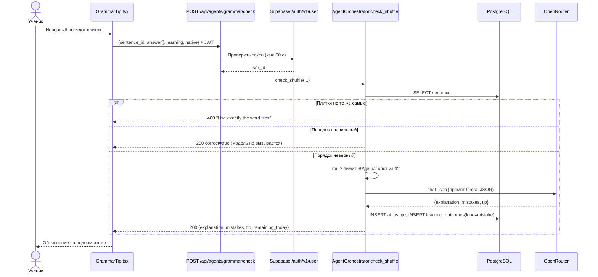
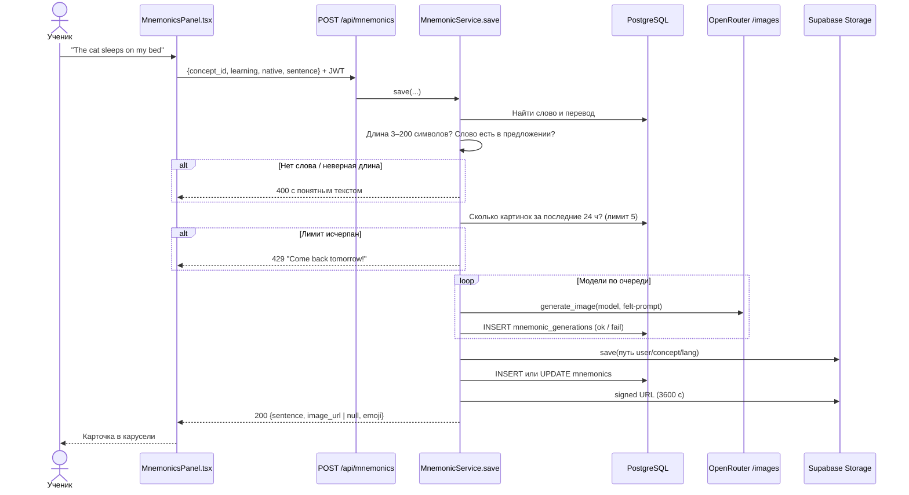
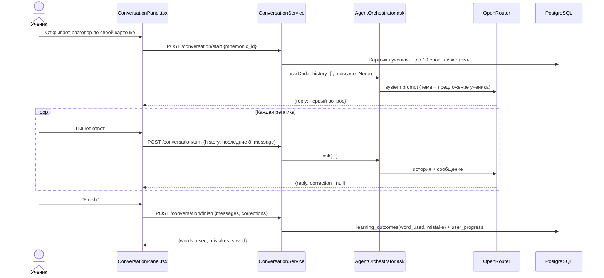

# 7. END-TO-END SCENARIOS — Три сценария от клика до базы

> Каждый сценарий проверен по коду. Общий путь запроса везде одинаковый: компонент React → функция в `frontend/src/lib/*Api.ts` → `fetch('/api/...')` с заголовком `Authorization: Bearer <JWT>` → Vite proxy → FastAPI route → `CurrentUser` (проверка токена у Supabase) → service → repository → PostgreSQL. **[VERIFIED]**

---

## Сценарий 1. Shuffle → ошибка → объяснение грамматики (Greta)

**Что видит пользователь:** собирает предложение из плиток, нажимает «Check», ответ неверный → появляется подсказка «почему так».

| Шаг | Где в коде | Что происходит |
|---|---|---|
| 1 | `components/lesson/GrammarTip.tsx` → `checkGrammar()` в `lib/agentsApi.ts` | Отправка ответа |
| 2 | `api/routes/agents.py: check_grammar` | Pydantic проверяет вход: до 40 плиток, каждая ≤60 символов, коды языков по шаблону |
| 3 | `deps.py: CurrentUser` | Токен проверяется у Supabase |
| 4 | `orchestrator.py: check_shuffle` | `same_words` — защита от подмены; правильный ответ не тратит лимит |
| 5 | `orchestrator.py: ask` | Кэш → лимит → семафор → вызов → журнал |
| 6 | БД | `ai_usage` (всегда), `learning_outcomes` (если есть объяснение) |

**Ошибки:** 401 (нет токена), 404 (предложение не найдено), 400 (чужие плитки), 429 (лимит или провайдер перегружен), 503 (все 4 слота заняты дольше 5 с), 200 + `message` (модель не ответила). **[VERIFIED]**

---

## Сценарий 2. Создать картинку-мнемонику («Create picture»)

**Что видит пользователь:** пишет своё предложение со словом → через несколько секунд появляется войлочная картинка (или эмодзи, если картинка не получилась).

**Важные детали [VERIFIED] (`services/mnemonics.py`):**
- Одна карточка на слово: повторное сохранение **обновляет** существующую (`find` → `update`), поэтому ответ всегда `200`, а не `201` (ADR 0004).
- Если ключей нет (`_can_draw = False`) — карточка сохраняется **без картинки**.
- Модель перегружена (429) → сразу эмодзи; другая ошибка модели → следующая модель; ошибка Storage → эмодзи. Пользователь **не видит ошибку**, только запасной вариант.
- Лимит — «скользящие» 24 часа (`clock() - timedelta(days=1)`), не календарный день.
- Картинки приватные: в базе хранится **путь**, а браузер получает временную подписанную ссылку.

---

## Сценарий 3. Разговор с Carla (start → turn → finish)

**Ключевые факты [VERIFIED]:**
- История разговора **живёт в браузере** (React state). Сервер её не хранит; `finish` получает её от клиента.
- Браузер отправляет `history.slice(-8)`; схема разрешает до 20 реплик, сообщение ≤300 символов.
- Каждый `start` и `turn` — отдельный вызов модели и **расходует дневной лимит** (30).
- На `finish` модель **не вызывается**: сервер сам ищет слова темы в сообщениях (`mask_sentence`) и повышает прогресс по ним.
- Слабость: так как `messages` и `corrections` приходят от клиента, ученик технически может «приписать» себе использованные слова. Это влияет только на его собственный прогресс. **[INFERRED]**
