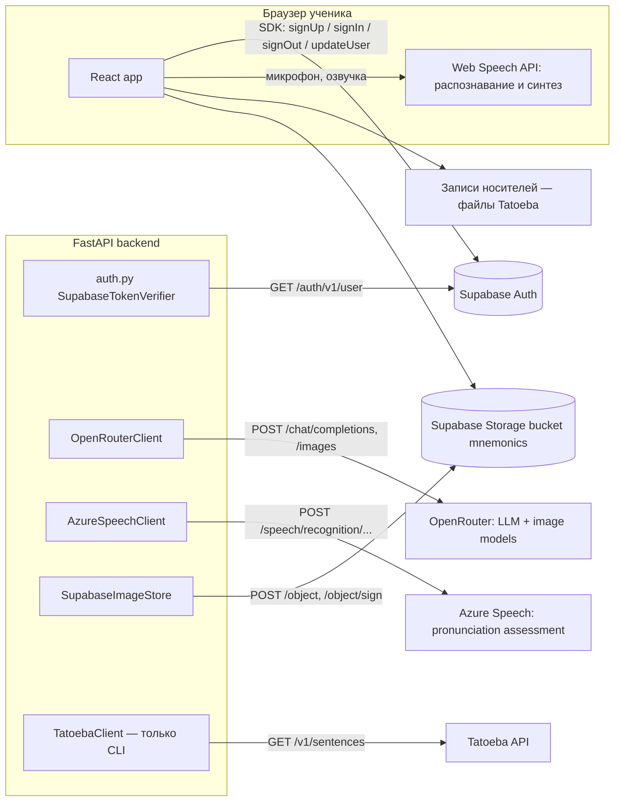

# 4. EXTERNAL INTEGRATIONS — Внешние сервисы

---

## 4.1. Пять видов «чужого кода», которые важно различать

| Понятие | Простое объяснение | Пример в TurtleTalk |
|---|---|---|
| **Мой backend API** | Сервер, который написала я; мой фронтенд к нему обращается | FastAPI: `POST /mnemonics`, `GET /lessons` |
| **External third-party API** | Чужой сервер, к которому обращается мой бэкенд по HTTP | Tatoeba API (`https://api.tatoeba.org/v1/sentences`), Supabase Storage |
| **AI model API** | Внешний API, где на другой стороне — модель машинного обучения | OpenRouter `POST /chat/completions` (LLM) и `POST /images`; Azure Speech (оценка речи) |
| **SDK** (Software Development Kit) | Готовая библиотека, которая скрывает HTTP-запросы за функциями | `@supabase/supabase-js` во фронтенде: `supabase.auth.signInWithPassword()`. **В бэкенде SDK не используются** — все внешние вызовы написаны вручную на `httpx` |
| **Webhook** | Обратный вызов: *чужой* сервис сам стучится в *мой* сервер, когда что-то произошло | **[NOT IMPLEMENTED]** — в проекте нет вебхуков; все запросы инициирует наш бэкенд или браузер |

**Аналогия.** Мой API — моя собственная касса. Внешний API — звонок поставщику. AI model API — звонок поставщику, у которого на линии отвечает робот, сочиняющий ответ. SDK — готовый телефон с кнопками быстрого набора. Вебхук — поставщик сам перезванивает, когда товар пришёл (у нас такого нет).

---

## 4.2. Карта интеграций



**Объяснение.** Большинство внешних вызовов делает **бэкенд** (ключи не попадают в браузер). Исключения: **вход/регистрация** — браузер напрямую говорит с Supabase через SDK (это нормально: используется публичный `anon key`); **картинки** и **аудио** браузер загружает напрямую по ссылкам, которые выдал бэкенд или которые лежат в базе; **Web Speech API** — встроен в браузер, это не сервер.

---

## 4.3. Supabase Auth

| Вопрос | Ответ |
|---|---|
| 1. Сервис | Supabase Auth — хранение пользователей, пароли, выдача JWT-токенов |
| 2. Зачем | Не писать свою регистрацию и хранение паролей (это сложно и опасно) |
| 3. Где в коде | Фронтенд: `frontend/src/lib/supabase.ts` (клиент), `lib/authApi.ts` (функции), `context/AuthContext.tsx`. Бэкенд: `src/langapp/auth.py` (`SupabaseTokenVerifier`), `api/deps.py` (`get_token_verifier`, `get_current_user`) |
| 4. Метод/эндпоинт | Фронт: `supabase.auth.signUp`, `signInWithPassword`, `signOut`, `updateUser`, `getSession`. Бэк: `GET {SUPABASE_URL}/auth/v1/user` |
| 5. Что отправляется | Фронт: e-mail, пароль, имя (`user_metadata.name`). Бэк: токен пользователя в `Authorization: Bearer …` + `apikey: <anon key>` |
| 6. Что приходит | Фронт: сессия с `access_token`. Бэк: JSON пользователя, из него берутся `id` (UUID) и `email` |
| 7. Аутентификация | Публичный `anon key` + токен конкретного пользователя |
| 8. Где ключи | Фронт: `frontend/.env` (`VITE_SUPABASE_URL`, `VITE_SUPABASE_ANON_KEY`) — **по задумке публичны**, попадают в JS-бандл. Бэк: `.env` (`SUPABASE_URL`, `SUPABASE_ANON_KEY`). Оба `.env` в `.gitignore` **[VERIFIED]** |
| 9. Ошибки | Не 200 → `AuthError("invalid or expired token")` → HTTP 401; сеть недоступна → `AuthError("cannot reach Supabase…")` → 401; если ключи не заданы → 503 «Login is not configured» |
| 10. Сервис недоступен | Все защищённые эндпоинты отвечают 401 (кроме уже закэшированных токенов на ≤60 с) |
| 11. Retry/timeout/limits | Таймаут 5 с, **без повторов**; кэш проверенных токенов 60 с (`cache_seconds=60`) **[VERIFIED]** |

**Пример из кода (`auth.py`):**
```python
response = self._http.get(self._url, headers={"apikey": self._anon_key, "Authorization": f"Bearer {token}"})
if response.status_code != 200:
    raise AuthError("invalid or expired token")
```

---

## 4.4. Supabase Storage (картинки карточек)

| Вопрос | Ответ |
|---|---|
| Сервис / зачем | Хранилище файлов; AI-картинки слишком большие для базы, их кладут в bucket `mnemonics` |
| Где | `src/langapp/integrations/supabase_storage.py`, `SupabaseImageStore`; используется в `services/mnemonics.py` |
| Эндпоинты | `POST /storage/v1/object/{bucket}/{path}` (загрузка, `x-upsert: true`), `POST /storage/v1/object/sign/{bucket}` (временные ссылки) |
| Отправляется | Байты картинки + `Content-Type`; для подписи — список путей и `expiresIn` (по умолчанию 3600 с, `SIGNED_URL_SECONDS`) |
| Приходит | Подтверждение загрузки; список `signedURL` |
| Аутентификация | `SUPABASE_SERVICE_ROLE_KEY` (секретный, **только бэкенд**). Для ключей нового формата `sb_secret_…` отправляется только `apikey`, для старых JWT-ключей — ещё и `Authorization` (`auth_headers`) **[VERIFIED]** |
| Ошибки | `StorageError` (наследник `ExternalSourceError`, HTTP 502) при не-200 или недоступности |
| Недоступен | В `MnemonicService._draw` и `_signed_urls` ошибки хранилища перехватываются (`except ExternalSourceError`): карточка сохраняется без картинки, показывается эмодзи **[VERIFIED]** |
| Retry/timeout | Таймаут 30 с, без повторов |

**Почему ссылки «подписанные».** Bucket приватный; бэкенд выдаёт ссылку, которая работает 1 час. Даже зная путь, без подписи картинку не открыть. **[VERIFIED]** `signed_urls`.

---

## 4.5. OpenRouter (LLM и генерация картинок)

| Вопрос | Ответ |
|---|---|
| Сервис | OpenRouter — «шлюз» к многим моделям разных компаний через один API в формате OpenAI |
| Зачем | Четыре текстовых агента и генерация картинок; можно использовать **бесплатные** модели и менять модель без изменения кода |
| Где | `src/langapp/integrations/openrouter.py`, класс `OpenRouterClient` |
| Методы | `chat_json(models, messages, user, max_tokens)` → `POST /chat/completions`; `generate_image(model, prompt, user)` → `POST /images`; `chat(...)` (простой чат — в коде **нигде не вызывается** **[VERIFIED]**) |
| Отправляется (чат) | `model` (первая модель), `models` (список запасных, если их несколько), `messages` (system + user), `max_tokens` (по умолчанию `AGENT_MAX_TOKENS=2000`), `temperature: 0.2`, `user` (UUID ученика — для статистики провайдера) |
| Отправляется (картинка) | `model`, `prompt` (предложение ученика + стиль «фетр, без текста»), `aspect_ratio: "1:1"`, `n: 1` |
| Приходит | Чат: `choices[0].message.content` (текст, ожидается JSON), фактическая `model`, `usage.total_tokens`. Картинка: `data[0].b64_json` (base64) и `media_type` |
| Аутентификация | `Authorization: Bearer <OPENROUTER_API_KEY>`, заголовок `X-Title: TurtleTalk` |
| Где ключ | `.env` → `OPENROUTER_API_KEY`; модели: `OPENROUTER_TEXT_MODEL` (по умолчанию `openrouter/free`), `AGENT_MODELS` (список через запятую), `OPENROUTER_IMAGE_MODEL` |
| Ошибки | 429 → `UpstreamRateLimited` (HTTP 429, «бесплатные модели заняты»); пустой ответ → ошибка с причиной (`finish_reason=length` → «модель исчерпала лимит токенов»); неверный формат → `OpenRouterError` (502) |
| Недоступен | Оркестратор ловит `ExternalSourceError` и возвращает **200** с `available=false` и понятным `message`; вызов пишется в `ai_usage` как неуспешный |
| Retry | Транспортная ошибка или 500/502/503/524/529 → **1 повтор** через 2 с (`max_retries=1`). Плюс на уровне агента `ask_with_retry` — **до 2 попыток**, если ответ пустой/неразборчивый. Плюс **fallback-модели** через поле `models` |
| Timeout | 120 с (`OPENROUTER_TIMEOUT_SECONDS`) |
| Rate limits | Свои: 30 AI-ответов в календарный день (UTC) на ученика (`AGENT_DAILY_LIMIT`), максимум 4 одновременных вызова (`AGENT_MAX_CONCURRENT`), 5 картинок за последние 24 часа (`MNEMONIC_DAILY_LIMIT`, `MnemonicService._remaining`) |

**Пример запроса (как строит `chat_json`):**
```json
{
  "model": "openrouter/free",
  "messages": [
    {"role": "system", "content": "You are a kind English grammar teacher. ... Reply with JSON only ..."},
    {"role": "user", "content": "{\"correct_sentence\": \"Call the doctor\", \"student_answer\": \"doctor the Call\"}"}
  ],
  "max_tokens": 2000,
  "temperature": 0.2,
  "user": "8c5b4a3e-..."
}
```

---

## 4.6. Azure Speech (оценка произношения)

| Вопрос | Ответ |
|---|---|
| Сервис | Microsoft Azure AI Speech, REST API распознавания коротких аудио с **Pronunciation Assessment** |
| Зачем | Браузерное распознавание говорит только «услышал/не услышал»; Azure даёт **баллы** (accuracy, fluency, completeness) по словам и звукам |
| Где | `src/langapp/integrations/azure_speech.py` (`AzureSpeechClient`), агент `services/agents/pronunciation.py` |
| Эндпоинт | `POST https://{region}.stt.speech.microsoft.com/speech/recognition/conversation/cognitiveservices/v1` |
| Отправляется | WAV-аудио в теле; заголовок `Pronunciation-Assessment` (base64-JSON с эталонным текстом и локалью, функция `assessment_header`) |
| Приходит | JSON с `RecognitionStatus`, общими баллами, баллами по словам (`ErrorType`, например `Omission`) и звукам; разбирается в `parse_assessment` → `PronunciationScore` |
| Аутентификация | `Ocp-Apim-Subscription-Key: <AZURE_SPEECH_KEY>`, регион в URL |
| Где ключ | `.env` → `AZURE_SPEECH_KEY`, `AZURE_SPEECH_REGION` |
| Ошибки | 429 → «Azure занят / закончились бесплатные часы»; 401/403 → «проверьте ключ и регион»; иначе `AzureSpeechError` |
| Недоступен / нет ключа | Агент не создаётся (`get_pronunciation_agent` → `None`), `GET /agents/pronunciation/support` отвечает `supported: false`, фронтенд не показывает оценку; в Control Room агент Paco — **blocked** |
| Retry/timeout | Таймаут 15 с, **без повторов** |
| Языки | `eng → en-US`, `spa → es-ES`, `cat → ca-ES` (русский **не поддерживается** в коде) **[VERIFIED]** `LOCALES` |

---

## 4.7. Tatoeba API (предложения и аудио)

| Вопрос | Ответ |
|---|---|
| Сервис | Tatoeba — открытая база предложений с переводами (лицензия CC BY 2.0 FR), часть с записями носителей |
| Зачем | Реальные предложения для Shuffle и Sentence Builder; аудио для кнопки Listen |
| Где | `src/langapp/ingestion/tatoeba_client.py` (`TatoebaClient`), `ingestion/parser.py`, `services/import_service.py`, `services/lesson_builder.py`, запуск — `src/langapp/cli.py` |
| Когда вызывается | **Только из CLI** (`make import`, `make import-builder`, `make build-lessons`), не во время работы ученика **[VERIFIED]** |
| Эндпоинт | `GET https://api.tatoeba.org/v1/sentences` с параметрами `lang`, `trans:lang`, `word_count`, `has_audio`, `include=audios`, `q` (поиск слова) + пагинация `paging.next` |
| Аутентификация | Не нужна (публичный API); отправляется `User-Agent: project-languages-v2/0.1 (student project)` |
| Ошибки | Плохие записи пропускаются парсером (`skipped` в `import_runs`), импорт пишет статус `failed` и текст ошибки |
| Retry | До **4 повторов** на 429/500/502/503/504 и сетевые ошибки, **экспоненциальная задержка** 1 → 30 с, уважает заголовок `Retry-After` |
| Rate limit (свой) | Не чаще 1 запроса в секунду (`TATOEBA_MIN_INTERVAL_SECONDS=1.0`) |
| Timeout | 10 с |
| Идемпотентность | `id` предложения Tatoeba = первичный ключ в `sentences`, поэтому повторный импорт не создаёт дубликатов («0 new rows») **[VERIFIED]** `README.md`, `repositories/sentences.py` |

---

## 4.8. Браузерные API (не серверы, но важны для демо)

| API | Где | Что делает |
|---|---|---|
| **Web Speech — SpeechRecognition** | `frontend/src/lib/speech.ts`, `PronounceStep.tsx` | Распознаёт сказанное слово в Chrome/Safari бесплатно; в других браузерах шаг можно пропустить |
| **Web Speech — speechSynthesis** | `hooks/useSpeechSynthesis.ts` | Озвучивает слова и реплики собеседника |
| **MediaDevices + запись WAV** | `lib/recordWav.ts` | Записывает голос в формат WAV для Azure |

---

## 4.9. Сводная таблица надёжности

| Интеграция | Timeout | Повторы | Свой лимит | Что видит ученик при сбое |
|---|---|---|---|---|
| Supabase Auth (бэк) | 5 с | нет (кэш 60 с) | — | 401, нужно войти снова |
| Supabase Storage | 30 с | нет | — | Карточка с эмодзи вместо картинки |
| OpenRouter (чат) | 120 с | 1 HTTP-повтор + до 2 попыток агента + запасные модели | 30/день, 4 одновременно | Текст «AI-учитель не смог ответить, попробуйте позже» |
| OpenRouter (картинки) | 120 с | перебор моделей из списка | 5 картинок/день | Карточка с эмодзи |
| Azure Speech | 15 с | нет | общий лимит 30/день | Сообщение об ошибке, оценка не показана |
| Tatoeba (CLI) | 10 с | до 4, экспоненциально | 1 запрос/с | Ученик не затронут (импорт заранее) |

Все значения **[VERIFIED]** по `config.py` и конструкторам клиентов.
