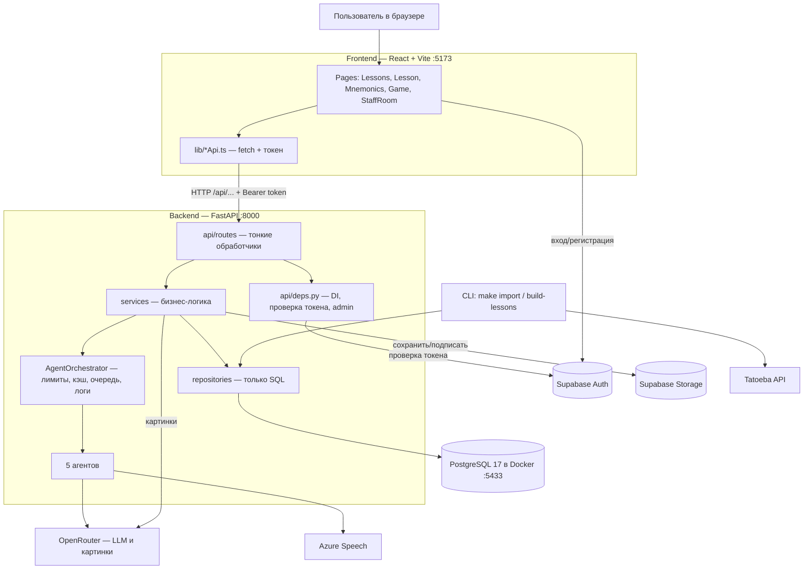
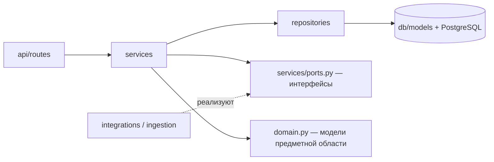
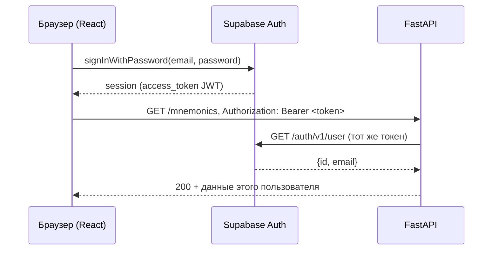
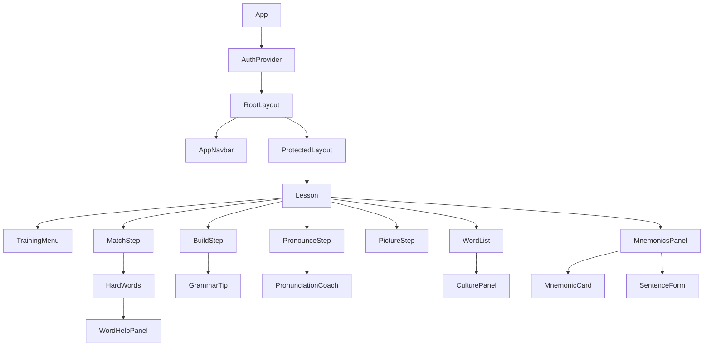

# 2. TECHNICAL ARCHITECTURE — Стек, архитектура и фронтенд

---

## 2.1. Технологический стек

### Активно используется

| Technology | Где используется | Зачем | Что делает (просто) |
|---|---|---|---|
| **Python 3.11+** | весь бэкенд `src/langapp/` | язык сервера | «Мозг» приложения: правила, работа с базой, вызовы AI |
| **FastAPI** | `api/main.py`, `api/routes/*` | веб-фреймворк для REST API | Принимает HTTP-запросы, вызывает нужную функцию, отдаёт JSON |
| **Pydantic v2** | `api/schemas.py`, `domain.py` | валидация данных | Проверяет, что в запросе правильные поля и типы, иначе ответ 422 |
| **pydantic-settings** | `config.py` | настройки из `.env` | Читает ключи и параметры из переменных окружения |
| **Uvicorn** | `Makefile` (`make api`) | ASGI-сервер | Программа, которая «слушает» порт 8000 и передаёт запросы в FastAPI |
| **SQLAlchemy 2** | `db/models.py`, `repositories/*` | ORM | Описывает таблицы как Python-классы и строит SQL-запросы |
| **Alembic** | `migrations/versions/*` (6 файлов) | миграции схемы | Версионирует изменения таблиц, как git для структуры базы |
| **PostgreSQL 17** | `docker-compose.yml` | реляционная база | Хранит предложения, слова, прогресс, карточки, логи AI |
| **psycopg 3** | драйвер в `DATABASE_URL` | связь Python ↔ PostgreSQL | «Провод» между SQLAlchemy и базой |
| **Docker / Docker Compose** | `docker-compose.yml`, `make db` | запуск базы | Поднимает PostgreSQL в контейнере на порту 5433 |
| **httpx** | `integrations/*`, `ingestion/tatoeba_client.py`, `auth.py` | HTTP-клиент | Бэкенд сам делает запросы во внешние API |
| **React 19** | `frontend/src` | UI-библиотека | Строит интерфейс из компонентов |
| **TypeScript ~5.9** | весь фронтенд | типизация | Ловит ошибки типов до запуска |
| **Vite 8** | `frontend/vite.config.ts` | dev-сервер и сборка | Быстрый запуск, прокси `/api` → `localhost:8000` |
| **React Router 7** | `frontend/src/App.tsx` | маршрутизация | Связывает URL (`/lessons/7`) со страницей |
| **Supabase Auth** (`@supabase/supabase-js`) | `lib/supabase.ts`, `lib/authApi.ts`, бэкенд `auth.py` | вход/регистрация | Хранит пользователей и выдаёт токены (JWT) |
| **Supabase Storage** | `integrations/supabase_storage.py` | хранение картинок | Сохраняет AI-картинки карточек, выдаёт временные ссылки |
| **OpenRouter** | `integrations/openrouter.py` | доступ к LLM и генерации картинок | Один API для многих моделей (бесплатные модели по умолчанию) |
| **Azure Speech** | `integrations/azure_speech.py` | оценка произношения | Сравнивает запись голоса с текстом, даёт баллы по звукам |
| **Tatoeba API** | `ingestion/tatoeba_client.py` | источник предложений и аудио | Реальные предложения с переводами и записями носителей |
| **Web Speech API** (браузер) | `lib/speech.ts`, `hooks/useSpeechSynthesis.ts` | распознавание и синтез речи | Бесплатно в Chrome/Safari: «скажи слово», «озвучь» |
| **GSAP** | `lib/useScrollReveal.ts`, лендинг | анимации | Плавное появление элементов при прокрутке |
| **Three.js + React Three Fiber + drei** | `components/controlroom/three/*` | 3D-сцена | Control Room с 3D-агентами (только на странице админа) |
| **pytest + respx** | `tests/*` (245 тестов) | тесты бэкенда | respx подменяет внешние HTTP-вызовы в тестах |
| **jsonschema + PyYAML** | `tests/test_usage_summary.py` | контрактные тесты | Проверяют, что ответы совпадают с `openapi.yaml` |
| **Vitest + Testing Library** | `frontend/src/**/*.test.tsx` (42 теста) | тесты фронтенда | Рендерят компоненты в jsdom и кликают как пользователь |
| **ruff, ESLint** | `pyproject.toml`, `frontend/eslint.config.js` | линтеры | Стиль кода и типичные ошибки |
| **GitHub Actions** | `.github/workflows/ci.yml` | CI | На каждый push: ruff + pytest (с Postgres), vitest + build |
| **MCP (Model Context Protocol)** | `src/langapp/mcp_server.py` | инструменты для AI-ассистента разработчика | 5 инструментов только для чтения базы (уроки, слабые слова, использование AI) |

### Есть в зависимостях, но используется ограниченно

| Technology | Ситуация |
|---|---|
| `src/langapp/web/index.html` | Простая страница, которую FastAPI отдаёт на `GET /` — основной UI это React. **[VERIFIED]** `api/main.py` |
| `uvicorn[standard]` | Используется только в разработке (`--reload`); продакшн-запуска нет. **[VERIFIED]** `Makefile` |

### Отсутствует (часто спрашивают)

| Что | Статус |
|---|---|
| Message queue (RabbitMQ, Redis, Kafka) | **[NOT IMPLEMENTED]** |
| Background workers (Celery, RQ) | **[NOT IMPLEMENTED]** — импорт данных запускается вручную через CLI |
| Agent framework (LangChain, LangGraph, CrewAI) | **[NOT IMPLEMENTED]** — оркестратор написан вручную |
| Деплой (сервер, облако, Docker-образ приложения) | **[NOT IMPLEMENTED]** — Docker только для базы |
| Мониторинг (OpenTelemetry, Grafana, Sentry) | **[NOT IMPLEMENTED]** — есть логирование (`logging`) и своя статистика AI |
| CORS-настройки | **[NOT IMPLEMENTED]** — в разработке не нужны, потому что Vite проксирует `/api` |

---

## 2.2. Общая архитектура

**Объяснение.** Браузер общается с двумя системами: напрямую с **Supabase** (вход и регистрация) и с нашим **FastAPI** (всё остальное). Каждый запрос к FastAPI несёт токен Supabase; бэкенд спрашивает у Supabase, кто этот пользователь. Внутри бэкенда запрос проходит слои: **route** (принять и проверить данные) → **service** (решить, что делать) → **repository** (SQL) → **PostgreSQL**. Если нужен AI, сервис зовёт **оркестратор**, а тот — нужного агента, который обращается к OpenRouter или Azure. **Tatoeba** вызывается не во время работы пользователя, а заранее — командой импорта из терминала. **[VERIFIED]** по файлам, указанным на схеме.

---

## 2.3. Бэкенд: слоистая (layered) архитектура

| Слой | Папка | Ответственность | Что ему запрещено (проверяет тест) |
|---|---|---|---|
| **Routes** | `src/langapp/api/routes/` | Принять HTTP, провалидировать (Pydantic), вызвать **один** сервис, вернуть схему | импортировать `repositories`, `db`, `sqlalchemy` |
| **Dependencies** | `src/langapp/api/deps.py` | Собрать сервисы (Dependency Injection), открыть **одну транзакцию на запрос**, проверить токен и права | — |
| **Services** | `src/langapp/services/` | Правила и сценарии (уроки, игры, прогресс, агенты) | импортировать `fastapi`, `langapp.api` |
| **Repositories** | `src/langapp/repositories/` | Только чтение/запись в базу | импортировать `services`, `api`, `fastapi` |
| **Integrations** | `src/langapp/integrations/` | HTTP-клиенты внешних сервисов | импортировать `services`, `repositories`, `db`, `api` |
| **Domain** | `src/langapp/domain.py`, `errors.py` | Модели и ошибки предметной области | ничего из других слоёв |

**[VERIFIED]** — правила записаны в `tests/test_architecture.py` (словарь `RULES`), тест проходит по всем импортам через `ast`.

**Зачем так сложно? (простая аналогия).** Ресторан: официант (route) принимает заказ и проверяет, что блюдо есть в меню; повар (service) решает, как готовить; кладовщик (repository) приносит продукты со склада (база). Официант не ходит на склад сам. Если поменять склад (другую базу), официант и повар не меняются.

**Одна транзакция на запрос.** `get_session()` в `deps.py` открывает `session_factory.begin()`: если сервис выбросил ошибку, все изменения запроса откатываются; если всё хорошо — фиксируются одним коммитом. **[VERIFIED]**

**Ошибки домена → HTTP-коды.** В `errors.py` у каждой ошибки есть `status_code` (`NotFound` 404, `InvalidRequest` 400, `RateLimited` 429, `ServiceUnavailable` 503, `ExternalSourceError` 502). Один обработчик в `api/main.py` (`handle_app_error`) превращает их в JSON `{"detail": "..."}`. Сервисы ничего не знают о HTTP. **[VERIFIED]**

---

## 2.4. Аутентификация и авторизация (кратко; подробно — документ 7)

- **Authentication** (кто ты?) — Supabase. Бэкенд **не проверяет подпись JWT сам**, а спрашивает Supabase (`SupabaseTokenVerifier.verify`) и кэширует ответ на 60 секунд. **[VERIFIED]** `auth.py`.
- **Authorization** (что тебе можно?) — двух уровней: любой вошедший пользователь (`CurrentUser`) и администратор по списку e-mail (`AdminUser`). Данные пользователя фильтруются по `user_id` в каждом запросе репозитория. **[VERIFIED]** `deps.py`, например `MnemonicRepository.get_for_user`.

---

## 2.5. Инфраструктура

| Компонент | Как запускается | Статус |
|---|---|---|
| PostgreSQL | `make db` → `docker compose up -d --wait`, порт 5433, том `pgdata`, скрипт создаёт `langapp_test` | **[VERIFIED]** |
| Миграции | `make migrate` → `alembic upgrade head` | **[VERIFIED]** |
| Импорт данных | `make import`, `make import-builder`, `make import-words`, `make import-concepts`, `make build-lessons` | **[VERIFIED]** `Makefile`, `cli.py` |
| Бэкенд | `make api` → `uvicorn … --reload --port 8000` | **[VERIFIED]** |
| Фронтенд | `make frontend` → `npm install && npm run dev` (порт 5173) | **[VERIFIED]** |
| CI | GitHub Actions: Python 3.12 + Postgres 16, Node 22 | **[VERIFIED]** `.github/workflows/ci.yml` |
| Продакшн/деплой | — | **[NOT IMPLEMENTED]** |

> ⚠️ **Расхождение:** локально Postgres **17** (`docker-compose.yml`), в CI — **16** (`ci.yml`). Для этого проекта не критично, но это стоит знать.

---

## 2.6. Фронтенд: как работает интерфейс

### Маршруты (`frontend/src/App.tsx`) **[VERIFIED]**

| URL | Страница | Нужен вход? |
|---|---|---|
| `/` | `Landing.tsx` — лендинг, анимация «змейки перевода» | нет |
| `/dashboard` | `Dashboard.tsx` — прогресс, следующая тема, AI-лимит | да |
| `/lessons` | `Lessons.tsx` — выбор языков + bento-карточки 7 тем | да |
| `/lessons/:lessonId` | `Lesson.tsx` — тема: тренировки, список слов, карточки-картинки | да |
| `/mnemonics` | `Mnemonics.tsx` — свои карточки, флешкарты, разговор с AI | да |
| `/game` | `Game.tsx` — свободная практика Word Match | да |
| `/sentence-builder` | `SentenceGame.tsx` — свободный Sentence Builder | да |
| `/staff-room` | `StaffRoom.tsx` — Control Room администратора | да (+ админ на бэкенде) |
| `*` | редирект на `/` | — |

**Защита маршрутов:** `ProtectedRoute` в `App.tsx` ждёт, пока `useAuth()` загрузит сессию, и если пользователя нет — `<Navigate to="/" />`. Это защита только **интерфейса**; настоящая защита данных — на бэкенде (токен). **[VERIFIED]**

### Иерархия компонентов (главная учебная страница)

**[VERIFIED]** — проверено через импорты (например, `GrammarTip` импортируется только в `BuildStep.tsx`).

### Структура папок фронтенда

| Папка | Что внутри |
|---|---|
| `pages/` | Страницы-маршруты |
| `components/lesson/` | Шаги тренировок (Match, Build, Pronounce, Picture), меню, список слов |
| `components/agents/` | UI агентов: GrammarTip-подобные панели, ConversationPanel, CulturePanel, PronunciationCoach, HardWords |
| `components/mnemonics/` | Карточки-картинки, форма предложения, флешкарты |
| `components/controlroom/` | 3D Control Room: `three/` (сцена, персонажи), `animation/` (машина состояний), панели |
| `components/atoms`, `ui`, `organisms` | Мелкие переиспользуемые элементы, навбар, layout |
| `context/` | `AuthContext.tsx` (провайдер), `useAuth.ts` (хук), `authContextValue.ts` (контекст) |
| `hooks/` | `useLanguages` (языки), `useSpeechSynthesis` (озвучка) |
| `lib/` | API-клиенты (`lessonsApi`, `agentsApi`, `mnemonicsApi`, `progressService`, `authApi`), утилиты |
| `styles/` | CSS по файлам: tokens, base, components, pages, staffroom, controlroom |

### Управление состоянием (state management)

- **Нет Redux/Zustand/React Query.** **[VERIFIED]** — поиск по коду ничего не находит.
- **Локальное состояние** — `useState` в компонентах (например, результаты тренировок в `Lesson.tsx`).
- **Глобальное состояние пользователя** — React Context: `AuthProvider` подписывается на `supabase.auth` и раздаёт `user`, `login`, `logout` через `useAuth()`. **[VERIFIED]** `context/AuthContext.tsx`.
- **Языки** — хук `useLanguages`: сначала `localStorage` (ключ в браузере), для вошедшего пользователя ещё и `GET/PUT /settings`. **[VERIFIED]** `hooks/useLanguages.ts`.
- **Паттерн «ключ загрузки»** — страницы хранят `{key, data, error}` и считают `loading = loaded.key !== key`, чтобы не показывать старые данные при смене языка. **[VERIFIED]** `pages/Lesson.tsx`, `pages/Lessons.tsx`.

### Общение с API

- Все запросы — обычный `fetch` на относительный путь `/api/...`. **[VERIFIED]**
- `getJson()` в `lib/lessonsApi.ts`: делает `fetch`, при ошибке достаёт `detail` из JSON и бросает `Error` с понятным текстом.
- `authHeaders()` в `lib/progressService.ts`: берёт текущую сессию Supabase и добавляет `Authorization: Bearer <token>`.
- **Vite proxy** (`vite.config.ts`): `/api/lessons` → `http://localhost:8000/lessons` (префикс `/api` убирается). **[VERIFIED]**

### Формы, загрузка и ошибки

- Формы — контролируемые компоненты на `useState` (например, `SentenceForm.tsx`: кнопка неактивна, пока предложение короче 3 символов). **[VERIFIED]**
- Загрузка — спиннер `
`; ошибки — `
`. **[VERIFIED]** `pages/Lessons.tsx`, `pages/Lesson.tsx`.
- AI-ответы всегда содержат поля `available` и `message`: если AI недоступен, UI показывает текст `message`, а не падает. **[VERIFIED]** `orchestrator._grammar_view`, `ConversationService._view`.

### Практический пример: «Когда пользователь нажимает "Create picture"…»

1. `SentenceForm.tsx` → `onSubmit(sentence)` → `MnemonicsPanel.submit(conceptId, sentence)`.
2. `saveMnemonic()` (`lib/mnemonicsApi.ts`) → `POST /api/mnemonics` с `{concept_id, learning, native, sentence}` и токеном.
3. Бэкенд: `routes/mnemonics.py::save_mnemonic` → `MnemonicService.save()` (`services/mnemonics.py`):
   - проверяет, что слово существует и переведено, длина 3–200 символов, **слово есть в предложении** (`mask_sentence`), иначе 400;
   - проверяет дневной лимит картинок (`MNEMONIC_DAILY_LIMIT`, по умолчанию 5) → иначе 429;
   - строит промпт `image_prompt()` («фетровая иллюстрация, без текста»), пробует модели по очереди (`_first_working_image`);
   - сохраняет картинку в Supabase Storage (`SupabaseImageStore.save`), путь — в таблицу `mnemonics`;
   - если все модели недоступны — карточка сохраняется **с эмодзи вместо картинки** (graceful degradation).
4. Ответ: карточка с подписанной временной ссылкой `image_url`.
5. Фронтенд: карточка появляется в карусели; через 2,5 с уезжает в конец ряда, в центр выходит следующее слово (`MnemonicsPanel.tsx`).

Все шаги **[VERIFIED]** по указанным файлам.
